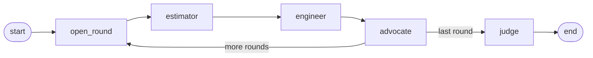

# CostCourt

> **Put your construction estimate on trial.** CostCourt is an AI-powered estimate review tool: three agents argue over every line, a judge rules, and every argument, rebuttal and ruling ends up in an auditable report.

[](.github/workflows/ci.yml)


## The idea

Checking a construction estimate is adversarial by nature: the person who wrote it defends it, the engineer questions quantities and specs, and the contractor pushes back on anything that squeezes the margin. This project models that process as a multi-agent debate:

| Agent | Role |
|---|---|
| **Estimator** | Wrote the estimate and defends quantities, unit rates and totals. |
| **Engineer** | Checks the technical side: scope gaps, wrong specs, quantities that don't match the design. |
| **Contractor's advocate** | Argues for realistic labour, logistics, risk and margin, and flags rates that are too low to be built for. |
| **Judge** | Reads the whole debate and rules on each disputed line: accepted, adjusted (with a new figure) or rejected, with reasoning. |

The debate runs as a **LangGraph** state machine over a configurable number of rounds. Every agent returns **Pydantic**-validated structured output from **Claude**, so the final report is data first and prose second.

## Tech stack

| | |
|---|---|
| **Backend** | Python 3.11+, FastAPI, LangGraph, Anthropic SDK (Claude), Pydantic v2 |
| **Client** | React 19, TypeScript, Vite, React Router, TanStack Query, Tailwind CSS v4, lucide icons |
| **Quality** | ruff, mypy (strict), pytest · oxlint, Prettier, Vitest + Testing Library · pre-commit · GitHub Actions |

## Quick start

Requires Python 3.11+ and Node 20.19+.

```bash
# Backend: http://127.0.0.1:8000/api/docs
cd backend
cp .env.example .env              # add your ANTHROPIC_API_KEY (optional for the demo)
python3 -m venv .venv
.venv/bin/pip install -e ".[dev]"
.venv/bin/costcourt

# Client: http://localhost:5173 (in a second terminal)
cd client
npm ci
npm run dev
```

**No API key yet?** Open the client, pick the warehouse sample and click **Watch a demo**. It replays a recorded debate through the real pipeline (graph, domain checks, live stream, verdict), so you can see the whole flow before spending tokens.

### Checks (same as CI)

```bash
cd backend && .venv/bin/ruff check . && .venv/bin/mypy && .venv/bin/pytest --cov
cd client && npm run lint && npm run typecheck && npm test
```

## Project layout

```
.
├── backend/                  # FastAPI + LangGraph service
│   ├── app/
│   │   ├── main.py           # app factory
│   │   ├── api/              # HTTP layer: router, routes/, shared deps
│   │   ├── core/             # settings, logging, base model, money types
│   │   ├── estimates/        # estimate model, sample catalog, /api/estimates
│   │   ├── debate/           # domain models, LangGraph flow, live sessions, /api/debates
│   │   └── agents/           # Claude client, role prompts, debaters and judge
│   └── tests/
├── client/                   # React + Vite single-page app
│   └── src/
│       ├── App.tsx           # root component: providers + router
│       ├── app/              # routes, query client
│       ├── api/              # typed API client
│       ├── features/         # one folder per screen
│       │   ├── home/         #   pages/ components/ hooks/
│       │   ├── debate/       #   pages/ components/ hooks/ utils/ (event reducer)
│       │   └── notFound/
│       ├── components/       # shared: ui/, layout/, estimateTable/, roleAvatar/, …
│       ├── hooks/            # shared hooks (useHealth)
│       ├── constants/        # roles, query keys, links
│       ├── types/            # API types (estimate, debate)
│       ├── utils/            # formatting, class names
│       └── styled/           # shared typography classes
└── .github/workflows/ci.yml  # backend + client jobs
```

The backend follows FastAPI's official full-stack template (`app/` with `api/` and `core/`). Business logic lives in feature packages (estimates, agents, debate, reports), so routes stay thin. In dev, Vite proxies `/api` to FastAPI, so no CORS setup is needed.

## Domain model

- **Estimate**: scope, location, currency, priced **line items** (quantity × unit rate) and **markups** (overhead, profit, contingency, tax). Totals are computed, never stored, so they can't drift.
- **Turn**: one debater's statement in a round, made of **arguments** about specific line items. Each argument either supports the line, proposes a higher or lower figure, or flags missing scope.
- **Verdict**: the judge's **rulings** per disputed line (accepted / adjusted / rejected), with reasoning and the debaters it sided with.
- **DebateReport**: the original estimate, every turn, the verdict, the revised estimate and the cost impact.

Money is `Decimal`, rounded half-up to cents. Models are immutable and reject unknown fields, and the same models serve as the agents' structured-output contracts.

Three sample estimates (`backend/app/estimates/samples/`) ship with deliberate, realistic problems for the agents to find: stale rates, under-measured reinforcement, missing waste allowances and a zero contingency on a risky site.

## Agents

Each agent is one structured-output call to Claude: the response is constrained to a Pydantic model's JSON schema and parsed into it.

- **Debaters** (estimator, engineer, contractor's advocate) receive the estimate and the transcript so far, and return a turn of arguments. The code, not the model, decides the round and the role.
- **The judge** receives the full transcript and must rule on every disputed line.
- **Domain checks run on every answer**: unknown line item ids, rebutting someone who hasn't spoken, a verdict that skips a disputed line or can't be applied. A failed check is sent back to the model with the reason, so it can correct itself.
- **The estimate is rendered once, deterministically, and marked for prompt caching**, so later turns reuse it cheaply.
- **Refusals** opt into the API's server-side fallback (`fallbacks: "default"`). A final refusal surfaces as a typed error.
- Agents depend on a small `StructuredLLM` protocol, not on the SDK, so all agent logic is tested with a scripted fake and no network.

Try one agent on a sample (makes a real API call):

```bash
cd backend
.venv/bin/python -m app.agents warehouse-slab --role engineer
```

## Debate flow

The debate is a LangGraph state machine. Every round, the three debaters speak in turn. After the last round, the judge rules and the verdict is applied to produce the revised estimate.



- **One graph serves every debate.** It is compiled once, and the agents are passed in through LangGraph's run context.
- **Nodes report progress with the stream writer.** The runner turns that into typed events: `debate_started`, `round_started`, `turn_started`, `turn_completed`, `judge_started`, `verdict_reached`, then `debate_completed` (with the full report) or `debate_failed`.
- **Debates run as background tasks.** Every event is kept, so a client that connects late, or reconnects with `Last-Event-ID`, gets the full history and then the live stream.
- **Agent failures** (API down, refusal, invalid output) end the stream with a readable `debate_failed` event, never a hanging connection.
- **The report** records every turn, the verdict, the revised estimate, the cost impact, and the model and token usage of each call.

| Endpoint | |
|---|---|
| `POST /api/debates` | Start a debate on `{"sample_id": "warehouse-slab"}` or `{"estimate": {...}}`, optional `rounds`. Returns `202` with the debate id. |
| `GET /api/debates/{id}/events` | Server-sent events: history, then live. Closes after the terminal event. |
| `GET /api/debates/{id}` | Status, and the full report once completed |
| `GET /api/debates` | Recent debates |

Run a full debate in the terminal (makes real API calls):

```bash
cd backend
.venv/bin/python -m app.debate warehouse-slab --rounds 1
```

Or through the API:

```bash
curl -s -X POST localhost:8000/api/debates -H 'content-type: application/json' \
  -d '{"sample_id": "warehouse-slab", "rounds": 1}'
curl -N localhost:8000/api/debates/<id>/events
```

## Web UI

- **Home:** choose one of the sample estimates (each hides a few realistic mistakes) or upload your own JSON. The server validates it before anything is spent. Then pick the number of rounds and start.
- **Live debate:** turns appear as each agent finishes. Every argument shows its stance, the line it targets, and the proposed figures next to the original ones. While an agent is working, a "thinking" card is shown, and a side panel shows who has spoken.
- **Verdict:** the judge's summary, the cost impact and confidence, a ruling for each disputed line (with whose argument it followed), recommendations, and a side-by-side revised estimate.
- **Under the hood:** state is derived from the event stream by one pure reducer (`features/debate/utils/debateState.ts`). Reconnects resume from `Last-Event-ID`, so refreshing the page replays the debate.

## Roadmap

The project is built in small, reviewable pull requests:

- [x] **1. Project setup**: FastAPI backend and React/Vite client skeletons, typed settings, linting, strict typing, tests, CI
- [x] **2. Domain model**: Pydantic models for estimates, line items, arguments, rulings and reports, plus sample estimates
- [x] **3. Agents**: Claude client wrapper, role prompts and structured outputs for the estimator, engineer, advocate and judge
- [x] **4. Debate graph**: LangGraph orchestration of rounds and judging, background debates with a live SSE event stream, tested with a fake LLM
- [x] **5. Web UI**: pick or upload an estimate, watch the debate live (SSE), read the verdict and the revised estimate. Includes a demo mode that needs no API key
- [ ] **6. Reports**: decision trail exported to Markdown, HTML and JSON
- [ ] **7. Polish**: Docker, screenshots, docs

## Configuration

All settings are environment variables (see [`backend/.env.example`](backend/.env.example)). The main ones:

| Variable | Default | |
|---|---|---|
| `ANTHROPIC_API_KEY` | — | Needed to run debates |
| `COSTCOURT_DEBATER_MODEL` | `claude-opus-5-5` | Model for the three debaters |
| `COSTCOURT_JUDGE_MODEL` | `claude-opus-5-5` | Model for the judge |
| `COSTCOURT_DEBATER_EFFORT` | `medium` | Thinking depth for debaters (`low` … `max`) |
| `COSTCOURT_JUDGE_EFFORT` | `high` | Thinking depth for the judge |
| `COSTCOURT_DEBATE_ROUNDS` | `2` | Number of rounds (1–5) |
| `COSTCOURT_DEMO_DELAY_S` | `2.5` | Simulated thinking time per agent in demo replays |
